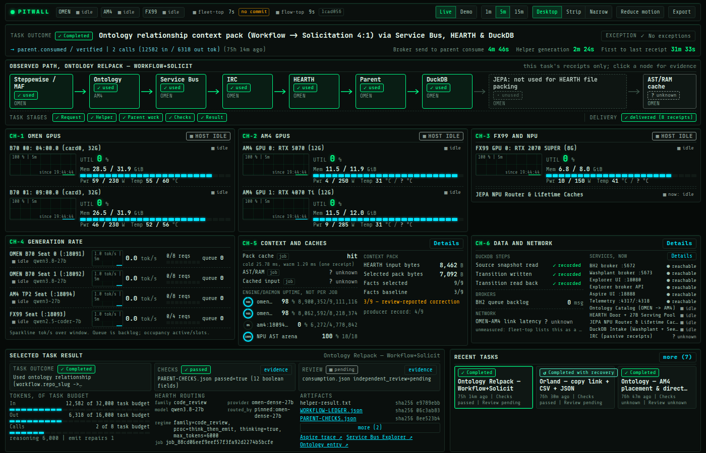

# Pitwall

A local, read-only instrument cluster for the AI workshop: what is happening across local compute seats, what the selected task actually touched, and what needs attention, with the underlying receipts and evidence one tap away.



## Quickstart

First-time setup on a fresh checkout:

```bash
uv sync
cd web && npm ci && npm run build
```

Manage the loopback service (`http://127.0.0.1:18110` by default):

```bash
./pitwall start     # starts on http://127.0.0.1:18110
./pitwall status    # prints health and source state
./pitwall stop      # stops only the recorded Pitwall PID
```

If port `18110` is busy, `start` refuses, leaves the existing process alone, and reports the next free port; override with `PITWALL_PORT`.

### Views

- **Desktop** (`1400×900`): Full six-channel instrument cluster, task-stage ribbon, observed topology path, context/cache inspection, and recent tasks without vertical scrolling at `1400×900`.
- **Strip** (`~137 CSS px`): Compact horizontal heads-up strip for docking at the top or bottom of a workstation display. Changes page layout only; it never resizes or pins the browser window.
- **Narrow** (`tablet / mobile`): Single-column responsive layout with section jump navigation.

Views are selected automatically by viewport width, via the header toggle, or with `?view=desktop|strip|narrow`.

## Architecture

```text
/dev/shm caches or --dump-json -> sources -> normalize + participation + corrections -> pitwall.v1 snapshot
run-directory receipts (mtime-aware) ---^                                                     |
                                              GET /api/snapshot, /api/history, /api/evidence/* |
                                              one TypeScript store -> desktop | strip | narrow
```

- `server/pitwall/`: FastAPI service bound to `127.0.0.1` with host-header validation. All routes are `GET`. One daemon collector thread per source, shared by all clients; a failed source retains its last good observation with its age marked stale or unreachable.
- `server/pitwall/contract.py` and `web/src/contract.ts`: The `pitwall.v1` schema contract, kept in lockstep across backend and frontend.
- `web/`: TypeScript, Vite, Tailwind v3 compiled at build time, inline SVG instruments, and bundled OFL fonts (`JetBrains Mono`, `Share Tech Mono`). Zero runtime CDN requests.
- `reference/stitch-export/`: Design reference export. `DESIGN.md` there is visual style reference only, not runtime evidence.

## Configuration & Sources

| Variable | Default | Meaning |
|---|---|---|
| `PITWALL_FLEET_CACHE` | `/dev/shm/fleet-top-snapshot.json` | `fleet-top` shared-memory snapshot |
| `PITWALL_FLEET_CMD` | `~/.local/bin/fleet-top --dump-json` | Fallback command when the cache is older than 6 s |
| `PITWALL_FLOW_CACHE` | `/dev/shm/flow-top-snapshot.json` | `flow-top` shared-memory snapshot |
| `PITWALL_FLOW_CMD` | `~/.local/bin/flow-top --dump-json` | Fallback command when the cache is older than 10 s |
| `PITWALL_RUN_ROOTS` | `~/work/bh2/ops1` | Colon-separated roots from which task evidence may be served |
| `PITWALL_FLOW_REPO` | `~/work/worktrees/flow-top-20261104` | Checkout whose commit and dirty state are reported for `flow-top` |
| `PITWALL_FLEET_REPO` | `~/work/listing` | Directory or checkout inspected for `fleet-top` |
| `PITWALL_WORK_ROOT` | `~/work` | Base workspace directory used to derive default repo and run roots |
| `PITWALL_PORT` | `18110` | Loopback HTTP port |

The `/dev/shm` caches stay fresh while a `fleet-top` or `flow-top` terminal is open. Otherwise Pitwall invokes the configured `--dump-json` commands as rate-limited subprocesses (at most every 5 s and 10 s). The header and source drawer indicate whether each source was read from `tui_cache` or `self_refresh`.

Pitwall is strictly read-only: it submits no model jobs, sends no broker messages, makes no ontology calls, restarts no services, and never opens a `.duckdb` file.

## Coverage

| Source | Status | Notes |
|---|---|---|
| `fleet-top`: 5 GPUs, 4 seats, NPU, cache counters | connected | Per device and per seat; memory is never summed across devices |
| `flow-top`: 10 latest tasks, service states | connected | 10-task cap has no CLI option |
| BH2 run-directory receipts | connected | Participation, checks, review, DuckDB steps, pack cache |
| Ontology, HEARTH, JEPA `:18097` | connected through `flow-top` and `fleet-top` | |
| BH2 broker `:5672`, Washplant broker `:5673` | observed directly, one row each | TCP connect and container state only; see below |
| Explorer UI and Explorer broker API | observed directly, one row each | UI link stays enabled with a backend-error note when discovery fails |
| Aspire UI, telemetry receiver `:4317`/`:4318` | observed directly, one row each | TCP only; span acceptance is not tested |
| Aspire traces, Explorer, Ontology UI | links only | Never proxied; disabled with a reason when unreachable |
| IRC | historical only | Per-task receipts; `flow-top` does not open IRC sockets, so current state reads `unknown` |
| OTel spans | evidence only | Served as a receipt; not plotted |
| Per-job cached input tokens (prefix reuse) | unavailable | Producer does not preserve per-job `cached_tokens` |
| Per-job AST/RAM cache | unavailable | No receipt attributes daemon counters to an individual job |
| OMEN–AM4 network latency | unavailable | `fleet-top` lists it as unmeasured |
| Host CPU and RAM | unsupported | Not in either collector |
| Washplant task | through `flow-top` only | Appears only when within the 10-task window |

## Evidence & Data Boundary Rules

Participation is derived from each task's receipts (`server/pitwall/participation.py`), never from `flow-top`'s default labels:

- **Unknown vs. Unused:** `flow-top`'s `not_used_by_job` is a dataclass default, not evidence. A missing receipt always reads **`unknown`**, never `unused`.
- **Checks & Reviews:** `flow-top` sets `checks_passed=True` and `review_status="review pending"` as constants for completed tasks. Pitwall requires a receipt (`PARENT-CHECKS.json`, `CHECKS.json`, `REVIEW-BUNDLE.json`, or `consumption.json`) before reporting check or review state.
- **Established Non-Use:** The only established `unused` state is JEPA for HEARTH file packing when a receipt explicitly records `desired.packed_files=[]`.
- **Correction Provenance:** `config/corrections.json` holds reviewed figures alongside producer figures (for example, showing `3/9 — review-reported correction` beside `producer record: 4/9` when a review report corrected a baseline).
- **Null Discipline:** `null` or unavailable sensor readings never coerce to `0`. A `0/0` cache ratio remains `unknown`; a measured `0.0%` over non-zero queries remains `0.0%`.

Evidence is served by `task_id` and content-hashed `record_id`, never by filesystem path, and only for allowlisted `.json`, `.jsonl`, `.md`, and `.png` files inside `PITWALL_RUN_ROOTS` (realpath-verified, symlinks rejected). `raw_irc_line`, secret-named keys, bearer tokens, and local host paths are redacted before serving.

## Endpoints

Instance identity lives in `config/endpoints.json`. Two brokers are never treated as equivalent merely because both run Service Bus emulators.

| Service | Host-facing | Container network | Identity |
|---|---|---|---|
| BH2 broker (`workflowkit-servicebus-emulator`) | `127.0.0.1:5672` | `workflowkit-servicebus-emulator:5672`, admin `:5300` | Shared workflow-kit emulator; queue `bh2-orland-help-20261104` is created at runtime |
| Washplant broker (`washplant-sb-emulator`) | `127.0.0.1:5673` | `washplant-sb-emulator:5672`, admin `:5300` | Dedicated emulator instance (`washplant-work`); not a replacement for BH2's broker |
| Explorer (`bh2-servicebus-explorer`) | `127.0.0.1:18080` | port `8080`, on the workflow-kit network | Attached to the BH2 broker only |
| Aspire (`lap1-aspire-dashboard`) | UI `:18888`, OTLP `:4317`, `:4318` | `18888`, `18889`, `18890` | Trace UI and OTLP receiver probed separately |

Probes perform TCP connect-and-close with no AMQP frames, HTTP `GET`, and `docker inspect` of container state (never container environment variables). Queue backlog comes only from Explorer for the BH2 broker and reads `unknown` when discovery fails.

## Modes

- **Live:** Shows current observations and honest gaps.
- **Demo:** Replaces the entire state with committed fixtures in `fixtures/`, stamps `demo:<scenario>` as every measurement's source, disables live evidence serving, and displays an amber `DEMO, <scenario>` banner across all layouts. See `fixtures/README.md`.

## Limitations

- **External collectors are not pinned by Pitwall's commit.** The header and the Sources drawer report each collector checkout's commit, dirty state, and whether Pitwall read a shared-memory cache or ran `--dump-json`.
- **Resource scope.** `evidence/live/resources.txt` records service CPU and RSS measurements. Browser JS heap is reported separately from total browser memory.

## Verification

```bash
uv run pytest                                # data-boundary and redaction unit tests
cd web && npm run build                      # TypeScript type-check and Vite production bundle
cd web && node scripts/verify-live.mjs       # Playwright verification against the running service
```

## Extending

- **New receipt or run type:** Add the file to `server/pitwall/sources/receipts.py` and a rule with its stated basis to `server/pitwall/participation.py`.
- **New source:** Add a polling loop in `server/pitwall/collector_loop.py`, a `SourceRecord`, and normalized fields in both `server/pitwall/contract.py` and `web/src/contract.ts`.
- **New instrument:** Compose from `web/src/components/` and render measurements through `reading()` so `null` stays `unknown`.

## License

Released under the [MIT License](LICENSE).
