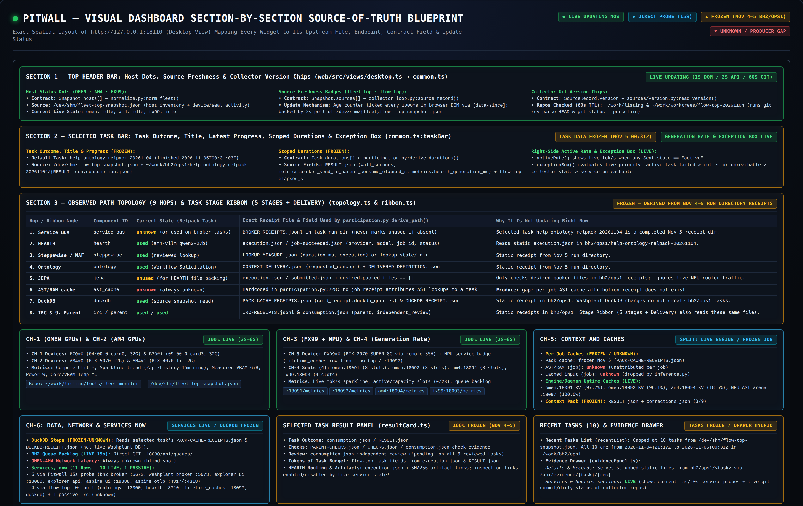
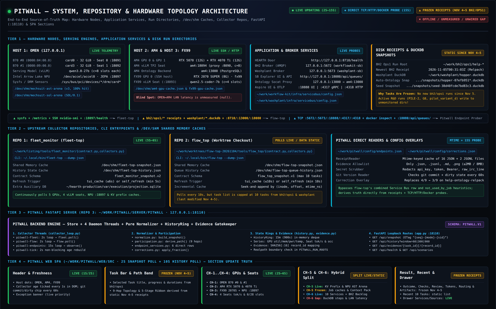
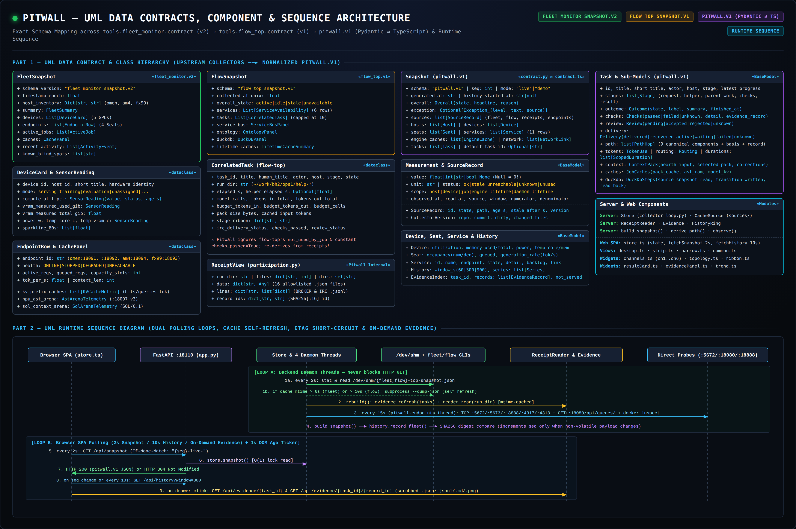
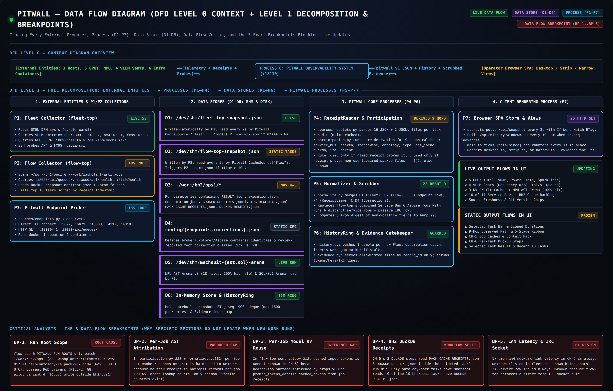

# Pitwall Architecture, UML Contracts & Data Flow Blueprints

This directory contains the reference architecture, UML data-contract hierarchy, Data Flow Diagram (DFD), and section-by-section source-of-truth blueprints for **Pitwall** (`pitwall.v1`).

For anyone building a read-only local AI instrument cluster across heterogeneous GPU/NPU nodes, message brokers, and run-directory receipts, these four diagrams document how hardware telemetry, passive disk receipts, and bounded endpoint probes are normalized into a single lock-free snapshot without coupling the UI to collector internals.

## Table of Contents

1. [Dashboard Section-by-Section Source-of-Truth Blueprint](#1-dashboard-section-by-section-source-of-truth-blueprint) (`pitwall-section-truth-map.png`)
2. [System, Repository & Hardware Topology Architecture](#2-system-repository--hardware-topology-architecture) (`pitwall-system-architecture.png`)
3. [UML Data Contracts, Component Hierarchy & Runtime Sequence](#3-uml-data-contracts-component-hierarchy--runtime-sequence) (`pitwall-uml-contracts.png`)
4. [Data Flow Diagram (DFD Level 0 + Level 1 & Breakpoint Analysis)](#4-data-flow-diagram-dfd-level-0--level-1--breakpoint-analysis) (`pitwall-dfd.png`)
5. [Contracts, Endpoints, Ports & Shared-Memory Caches Reference](#5-contracts-endpoints-ports--shared-memory-caches-reference)

---

## 1. Dashboard Section-by-Section Source-of-Truth Blueprint

Maps every visual section of the Pitwall Desktop layout (`http://127.0.0.1:18110`) to its exact upstream file, `/dev/shm` cache, HTTP/TCP probe, `pitwall.v1` contract field, and live vs. receipt-frozen update behavior.

---

## 2. System, Repository & Hardware Topology Architecture

End-to-end four-tier topology across:
- **Tier 1:** Hardware nodes (`omen` Dual Arc Pro B70 + Intel Arrow Lake NPU, `am4` Dual RTX TP2 + PostgreSQL Ontology backend, `fx99` RTX 2070 SUPER), application containers (HEARTH `:8710`, BH2 Broker `:5672`, Washplant Broker `:5673`, Service Bus Explorer `:18080`, Aspire `:18888` / OTLP `:4317` & `:4318`), and run directories (`~/work/bh2/ops1/*`, `~/work/washplant/*.duckdb`).
- **Tier 2:** Upstream collector checkouts (`~/work/listing/tools/fleet_monitor` and `~/work/worktrees/flow-top-20261104/tools/flow_top`), CLI fallback entrypoints (`~/.local/bin/fleet-top --dump-json`, `~/.local/bin/flow-top --dump-json`), `/dev/shm` caches, and Pitwall's direct receipt & config overlays.
- **Tier 3:** Pitwall FastAPI backend (`~/work/pitwall/server/pitwall`, loopback `:18110`), four daemon collector threads, pure normalizer, 15-minute `HistoryRing`, and allowlisted `Evidence` gatekeeper.
- **Tier 4:** TypeScript SPA (`~/work/pitwall/web/src`) polling `/api/snapshot` (2 s with `ETag` short-circuit) and `/api/history` (10 s).

---

## 3. UML Data Contracts, Component Hierarchy & Runtime Sequence

- **Part 1 (Contract & Class Hierarchy):** Traces how `FleetSnapshot` (`fleet_monitor_snapshot.v2`) and `FlowSnapshot` (`flow_top_snapshot.v1`) combine with Pitwall's internal `ReceiptView` (`server/pitwall/participation.py`) into the unified `Snapshot` (`pitwall.v1`), mirrored between `server/pitwall/contract.py` (Pydantic) and `web/src/contract.ts` (TypeScript).
- **Part 2 (Runtime Sequence):** Shows the decoupled two-loop design—backend daemon threads (`pitwall-fleet`, `pitwall-flow`, `pitwall-endpoints`, `pitwall-tick`) rebuild the in-memory `Snapshot` and `HistoryRing` asynchronously so `GET /api/snapshot` never blocks on a collector subprocess, socket probe, or disk scan.

---

## 4. Data Flow Diagram (DFD Level 0 + Level 1 & Breakpoint Analysis)

Decomposes the system into external entities, seven processes (`P1`–`P7`), six data stores (`D1`–`D6`), and the **five explicit data-flow breakpoints (`BP-1`–`BP-5`)** that separate live hardware/service telemetry from historical task receipts:

- **BP-1 (Run Root Scope):** `flow-top` and `PITWALL_RUN_ROOTS` inspect `~/work/bh2/ops1` (and `~/work/washplant/artifacts`). When active R&D workloads write to other directories, hardware telemetry (`CH-1`–`CH-4`, engine caches, service probes) updates live while task panels reflect the latest completed `bh2/ops1` run directory.
- **BP-2 (Per-Job AST Cache Attribution):** `participation.py` and `normalize.py` report per-job `ast_cache` / `caches.ast_ram` as `unknown` unless a job receipt explicitly attributes NPU AST arena lookups to that task; daemon-uptime AST arena hit rates (`:18097`) are reported separately under `engine_caches`.
- **BP-3 (Per-Job Model KV Reuse):** Reported as `unknown` when the upstream inference receipt omits per-job `prompt_tokens_details.cached_tokens`, while engine-uptime KV prefix cache hit rates (`:18091`, `:18092`, `am4:18094`) update live.
- **BP-4 (Per-Task DuckDB Steps):** `CH-6` DuckDB steps reflect the selected task's `PACK-CACHE-RECEIPTS.json` and `DUCKDB-RECEIPT.json` receipts rather than unattributed background table counts.
- **BP-5 (Unmeasured Cross-Host Latency & Zero-Socket IRC Rule):** `omen-am4` network latency is surfaced as `unknown` (`known_blind_spots`), and current IRC state is `unknown` by design because `flow-top` enforces a zero-socket rule for IRC (reading per-task delivery from `IRC-RECEIPTS.jsonl` only).

---

## 5. Contracts, Endpoints, Ports & Shared-Memory Caches Reference

| Surface / Component | Contract / Endpoint / Path | Poll / Refresh Cadence | Role in Pitwall |
|---|---|---|---|
| **Pitwall Loopback Server** | `http://127.0.0.1:18110` (`GET /api/{snapshot,history,evidence,scenarios,health}`) | Browser polls `2 s` (`/api/snapshot`), `10 s` (`/api/history`) | Serves prebuilt `pitwall.v1` JSON with `ETag`, 15m history series, and scrubbed evidence records |
| **Fleet Collector Cache** | `/dev/shm/fleet-top-snapshot.json` (`fleet_monitor_snapshot.v2`) | Read every `2 s`; `--dump-json` fallback if mtime `> 6 s` (min `5 s`) | Supplies 5 GPUs (`B70#0`, `B70#1`, `AM4#0`, `AM4#1`, `FX99#0`), 4 seats, NPU `:18097`, and engine KV caches |
| **Flow Collector Cache** | `/dev/shm/flow-top-snapshot.json` (`flow_top_snapshot.v1`) | Read every `2 s`; `--dump-json` fallback if mtime `> 10 s` (min `10 s`) | Supplies up to 10 correlated tasks and service health for Ontology (`:13000`), HEARTH (`:8710`), JEPA (`:18097`), and DuckDB |
| **OMEN B70 Seats 0 & 1** | `127.0.0.1:18091`, `127.0.0.1:18092` (HAProxy `:18095`) | Polled via `fleet-top` (`/metrics`) | Dual Intel Arc Pro B70 (32 GiB each) serving `qwen3.8-27b` (`c=8` slots per seat) |
| **OMEN NPU Hybrid Router** | `http://127.0.0.1:18097/health` + `/dev/shm/mechsuit-ast-arena` | Polled via `fleet-top` & `flow-top` | Intel Arrow Lake NPU (`/dev/accel/accel0`) + content-addressed AST arena (`mechsuit-shm-ast-arena.v3`) |
| **AM4 TP2 Seat & Ontology** | `am4:18094` (proxy `:8090`), `127.0.0.1:13000 -> am4:13000` | Polled via `fleet-top` & `flow-top` | Dual RTX (`RTX 5070` + `RTX 4070 Ti`) serving `qwen3-27b` (`c=8`) + PostgreSQL Ontology catalog |
| **FX99 Seat** | `fx99:18093` (`fx99-vllm.service`) | Polled via `fleet-top` over SSH | `RTX 2070 SUPER` (8 GiB) serving `qwen2.5-coder-7b` (`c=4` slots) |
| **HEARTH Door** | `http://127.0.0.1:8710/health` | Polled via `flow-top` | Local model execution router, usage accounting, and job receipt producer |
| **BH2 & Washplant Brokers** | `127.0.0.1:5672` (`workflowkit-servicebus-emulator`), `127.0.0.1:5673` (`washplant-sb-emulator`) | Direct Pitwall probe every `15 s` (`config/endpoints.json`) | Separate AMQP broker instances probed via TCP connect + `docker inspect` |
| **Service Bus Explorer** | `http://127.0.0.1:18080/` & `http://127.0.0.1:18080/api/queues/` (`bh2-servicebus-explorer`) | Direct Pitwall probe every `15 s` | Read-only queue discovery and backlog measurement for the BH2 broker (`:5672`) |
| **Aspire Dashboard & OTLP** | `127.0.0.1:18888` (UI), `127.0.0.1:4317` (gRPC), `127.0.0.1:4318` (HTTP) (`lap1-aspire-dashboard`) | Direct Pitwall probe every `15 s` | Trace inspection UI and OTLP span receivers probed as independent service rows |
| **Run Directory Receipts** | `~/work/bh2/ops1/*` (`PITWALL_RUN_ROOTS`) | Mtime-keyed scan on every `rebuild()` | Authoritative source for per-task 9-hop participation (`derive_path`), checks, review, durations, and servable evidence |
